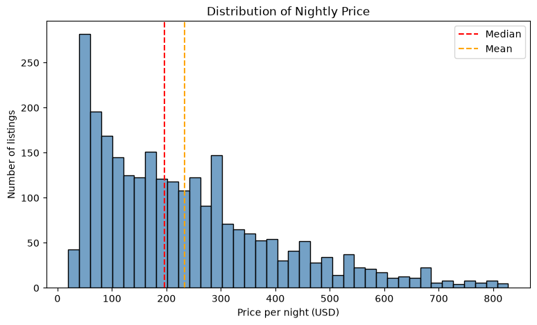
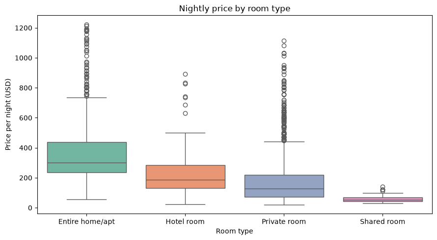
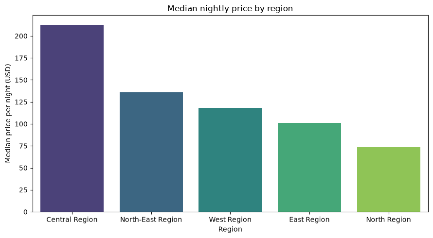
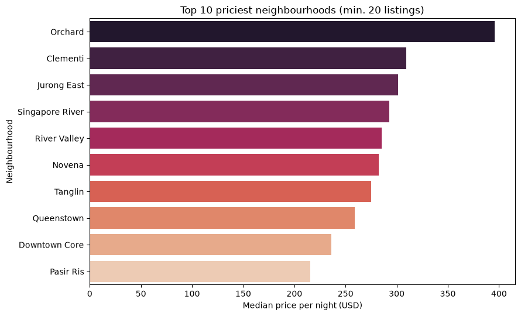
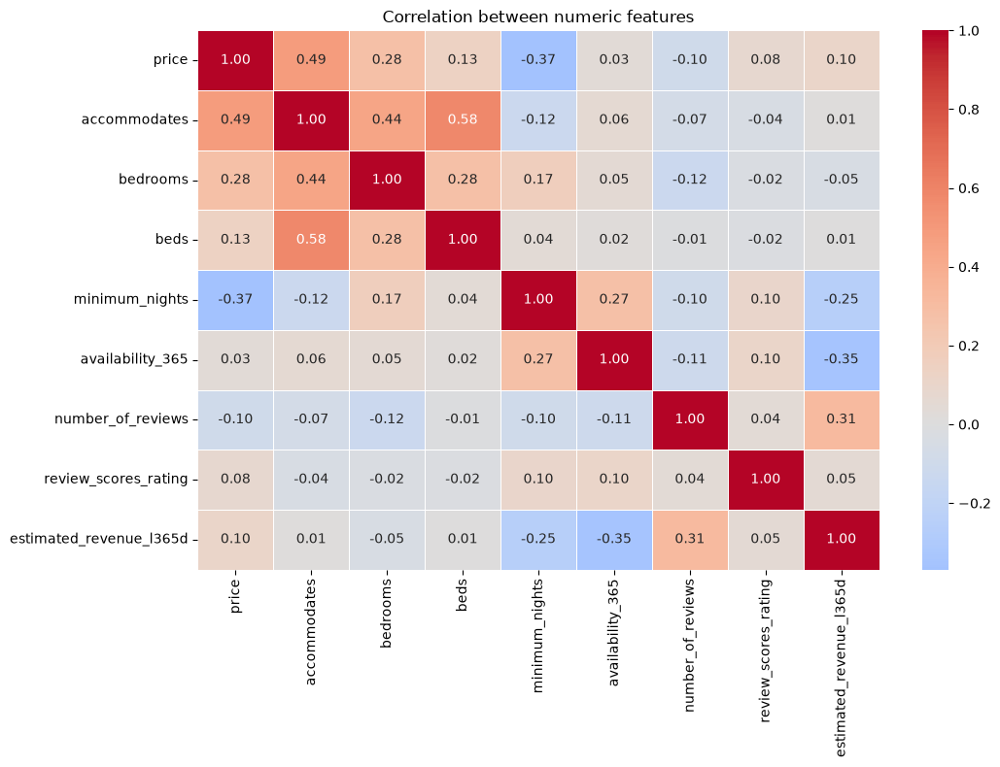
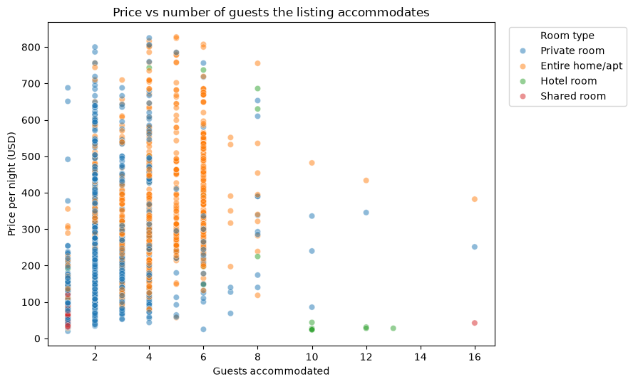
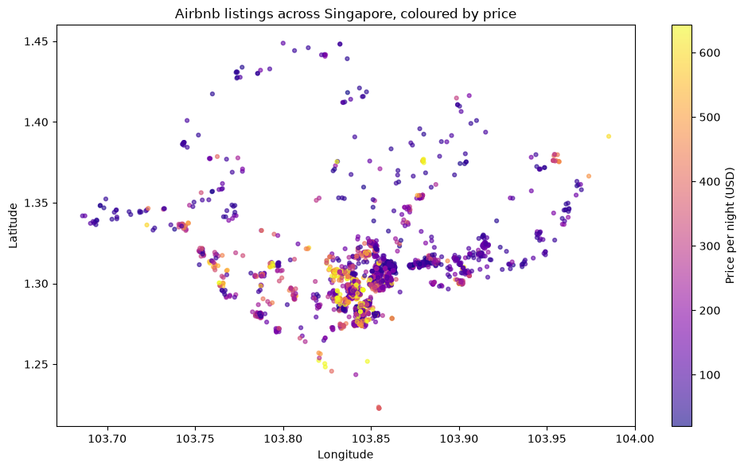

# Airbnb Singapore: What Drives Nightly Prices?

## 1. Business Question

**What factors influence Airbnb nightly prices in Singapore, and where and what type of listing should a new host choose to maximise potential revenue?**

The analysis looks at how room type, size, location, minimum stay and host quality relate to price, and then checks which kinds of listings actually earn money.

## 2. Dataset

- **Name:** Airbnb Singapore listings (`airbnb_singapore.csv`)
- **Source:** [Inside Airbnb – Get the Data](https://insideairbnb.com/get-the-data/) (Singapore listings file, last scraped 26-09-2026)
- **Size:** 3,208 rows × 90 columns in the raw file. After cleaning: **2,645 rows × 14 columns**.
- **Key columns used:**

| Column | Meaning |
|---|---|
| `price` | Nightly price in USD |
| `room_type` | Entire home/apt, Private room, Hotel room or Shared room |
| `neighbourhood_group_cleansed` | Region of Singapore (Central, East, West, North, North-East) |
| `neighbourhood_cleansed` | Specific neighbourhood (e.g. Orchard, River Valley) |
| `accommodates`, `bedrooms`, `beds` | Size of the listing |
| `minimum_nights` | Shortest stay the host accepts |
| `availability_365` | Days per year the listing is open for booking |
| `number_of_reviews`, `review_scores_rating` | Guest feedback |
| `host_is_superhost` | Whether the host has Superhost status |
| `estimated_revenue_l365d` | Estimated revenue over the last 365 days |

## 3. Tools Used

- **Python 3** in a Jupyter Notebook
- **pandas** and **numpy** for cleaning and analysis
- **matplotlib** and **seaborn** for visualisation

## 4. Steps Followed

1. **Loaded** the raw file and checked its shape and data types.
2. **Selected** the 14 columns relevant to the business question and dropped columns that were completely empty.
3. **Fixed data types:** removed the `$` and `,` from `price` and converted it to a number; converted Superhost `t`/`f` to True/False.
4. **Checked duplicates:** none found.
5. **Handled missing values:** dropped 480 listings with no price; filled missing `bedrooms`, `beds` and `minimum_nights` with the median.
6. **Handled outliers:** removed listings above the 99th percentile of price (about $1,245) and one listing under $10. In total 27 rows were removed.
7. **Explored the data** with group-by summaries for room type, region, neighbourhood and Superhost status, plus a correlation check against price.
8. **Visualised** price distribution, price by room type and region, top neighbourhoods, a correlation heatmap, price against guest capacity, and a map of listings.

## 5. Key Insights

1. **Singapore Airbnb is almost entirely a Central Region story.** About 85% of cleaned listings (2,256 of 2,645) are in the Central Region, which also has the highest median price (about $213 a night). The North Region is the cheapest at about $73, with only 34 listings.

2. **Room type is the biggest price divider.** The median entire home costs about $300 a night, compared with about $188 for a hotel room, $126 for a private room and $52 for a shared room. An entire home costs roughly 2.4 times a private room.

3. **Price is right-skewed.** The mean ($233) sits well above the median ($197), with a skewness of 1.09. A small group of luxury listings pulls the average up, so the median is the fairer number to quote.

4. **Bigger listings charge more.** The number of guests a listing accommodates has the strongest positive link with price (correlation 0.49), followed by bedrooms (0.28).

5. **Long minimum stays come with cheaper nights.** `minimum_nights` has a negative correlation with price (-0.37), so hosts who only accept longer stays tend to charge less per night.

6. **Orchard is the priciest area.** It leads at about $395 median, followed by Clementi (about $305) and Jurong East (about $302). Clementi and Jurong East have only 25 to 50 listings, so treat them with some caution.

7. **Superhosts charge a bit more and are rated higher.** Median price is $224 for Superhosts against $193 for other hosts, and their median rating is 4.86 against 4.60.

8. **Most listings are not earning.** About 69% have zero estimated revenue over the last 12 months, and the median listing is open for booking about 345 days a year.

9. **Cheaper rooms can earn more.** Among listings that did earn, private rooms had the highest median yearly revenue (about $10,700), ahead of entire homes (about $8,300) and hotel rooms (about $7,500), even though private rooms charge less per night.

**Recommendation for a new host:** a well-located private room or small home in the Central Region is a sensible start, since private rooms earned the most among active listings. Expect heavy competition from professional hosts.

## 6. Outputs

**Distribution of nightly price**


**Nightly price by room type**


**Median nightly price by region**


**Top 10 priciest neighbourhoods (minimum 20 listings)**


**Correlation between numeric features**


**Price vs number of guests accommodated**


**Airbnb listings across Singapore, coloured by price**


## 7. How to Run or Open

1. Clone or download this repository.
2. Download the Singapore listings file from [Inside Airbnb](https://insideairbnb.com/get-the-data/), save it as `airbnb_singapore.csv`, and place it in the same folder as the notebook.
3. Install the libraries:
   ```bash
   pip install pandas numpy matplotlib seaborn jupyter
   ```
4. Start Jupyter and open the notebook:
   ```bash
   jupyter notebook Airbnb_Singapore.ipynb
   ```
5. Run all cells from top to bottom (**Kernel → Restart & Run All**).

You can also view the notebook directly on GitHub without running anything.

## Author
**Afnan M** 