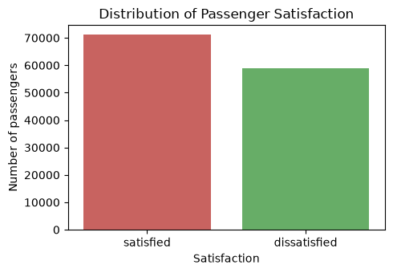
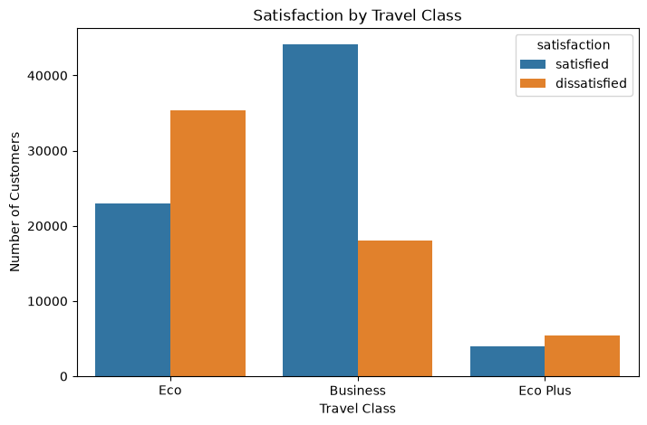
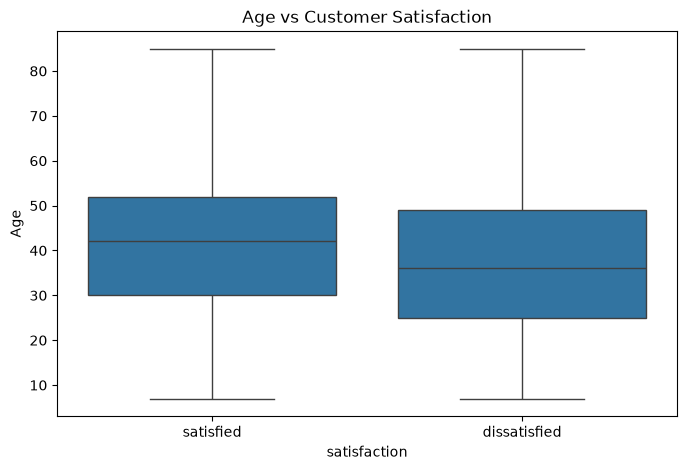
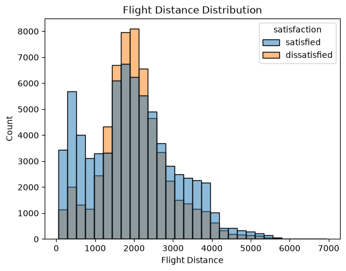
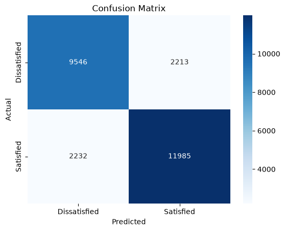
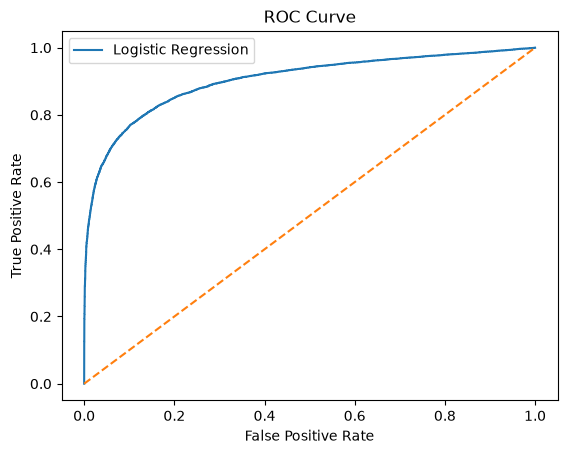
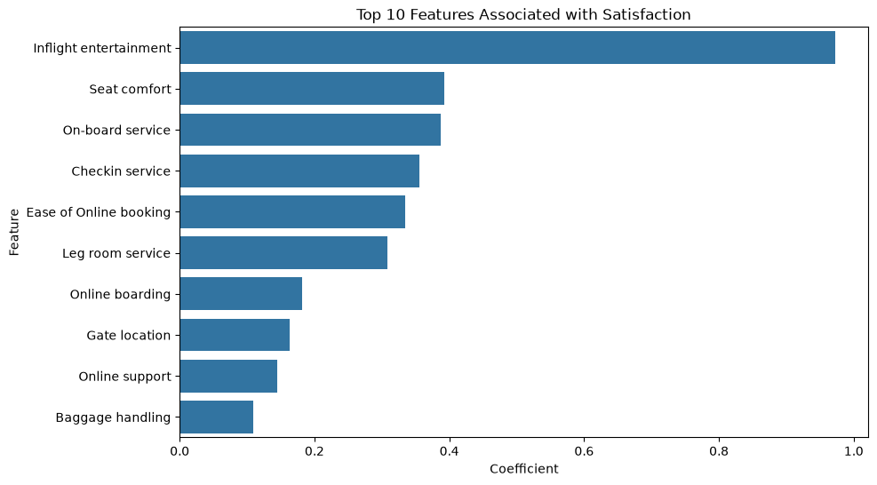

# Airline Passenger Satisfaction Prediction

## 1. Business Question

**Which factors make airline passengers satisfied or dissatisfied, and can we predict a passenger's satisfaction from their profile and their ratings of the flight experience?**

The goal is to help an airline see which parts of the service matter most, so it can decide where to invest to improve satisfaction.

## 2. Dataset

- **Name:** Invistico Airline passenger satisfaction survey (`Invistico_Airline.csv`)
- **Source:** Kaggle – Airline Passenger Satisfaction (Invistico Airline): `https://www.kaggle.com/datasets/teejmahal20/airline-passenger-satisfaction`
- **Size:** 129,880 rows and 23 original columns (a helper column, `satisfaction_flag`, is also present in the notebook and is excluded from the model).
- **Target:** `satisfaction` (satisfied: 71,087 passengers, dissatisfied: 58,793 passengers).
- **Key columns:**

| Column group | Columns |
|---|---|
| Passenger profile | `Gender`, `Customer Type` (loyal / disloyal), `Age`, `Type of Travel` (business / personal), `Class` (Business / Eco / Eco Plus), `Flight Distance` |
| Service ratings (0 to 5) | `Seat comfort`, `Food and drink`, `Inflight entertainment`, `Inflight wifi service`, `On-board service`, `Leg room service`, `Cleanliness`, `Baggage handling`, `Checkin service`, `Online boarding`, `Ease of Online booking`, `Online support`, `Gate location`, `Departure/Arrival time convenient` |
| Delays | `Departure Delay in Minutes`, `Arrival Delay in Minutes` |

## 3. Tools Used

- **Python 3** in a Jupyter Notebook
- **pandas** and **numpy** for data handling
- **matplotlib** and **seaborn** for charts
- **scikit-learn** for train/test split, one-hot encoding, scaling, Logistic Regression and evaluation metrics

## 4. Steps Followed

1. **Loaded and inspected** the data: shape, column names, data types, summary statistics.
2. **Checked quality:** no duplicate rows; 393 missing values in `Arrival Delay in Minutes`, filled with the median.
3. **Explored the target and key features** with charts: satisfaction split, satisfaction by travel class, age against satisfaction, and flight distance.
4. **Prepared the features:** dropped `satisfaction`, `satisfaction_flag` and `Gender`; encoded the target as 0 (dissatisfied) and 1 (satisfied).
5. **Split the data** 80% training and 20% testing (103,904 and 25,976 rows), stratified so both sets keep the same satisfied/dissatisfied balance.
6. **Encoded and scaled:** one-hot encoded the categorical columns (first category dropped), then standardised all features, fitting only on the training data.
7. **Trained** a Logistic Regression model.
8. **Evaluated** it with accuracy, precision, recall, F1, ROC-AUC, a confusion matrix and an ROC curve.
9. **Interpreted** the model using its coefficients to see which features push satisfaction up or down.

## 5. Key Insights

1. **The passengers are fairly evenly split.** About 55% are satisfied (71,087) and 45% are dissatisfied (58,793), so the model is not working with a badly lopsided target.

2. **Inflight entertainment is the strongest driver of satisfaction.** It has the largest positive coefficient (0.97), well ahead of everything else. Better entertainment is associated with a much higher chance of a satisfied passenger.

3. **Comfort and service follow behind.** Seat comfort (0.39), on-board service (0.39), check-in service (0.36), ease of online booking (0.33) and leg room (0.31) are the next strongest positive factors.

4. **Disloyal customers are the least satisfied group.** Being a disloyal customer has the largest negative coefficient (-0.73), so these passengers are much less likely to be satisfied than loyal ones, when everything else is equal.

5. **Economy and personal travel go with lower satisfaction.** Economy class (-0.35) and personal travel (-0.35) both lower the chance of satisfaction compared with Business class and business travel.

6. **Business class passengers are mostly satisfied; economy passengers are not.** In the class chart, Business has far more satisfied than dissatisfied passengers, while Eco and Eco Plus have more dissatisfied than satisfied.

7. **Satisfied passengers tend to be a little older.** The median age of satisfied passengers is higher than that of dissatisfied ones in the age chart.

8. **Longer arrival delays reduce satisfaction.** The arrival delay coefficient is negative (-0.26), as expected.

9. **The model predicts satisfaction well, but not perfectly.** Logistic Regression reached 82.89% accuracy, 84.41% precision, 84.30% recall, 84.36% F1 and a ROC-AUC of 90.35%. In plain terms, it classifies roughly 83 out of every 100 passengers correctly.

**Recommendation for the airline:** invest first in inflight entertainment, then seat comfort, on-board service and check-in, and look at how to improve the economy experience and win over disloyal customers.

**Limitations:**
- Logistic Regression assumes a linear relationship between the inputs and the log-odds of satisfaction, so it can miss more complex patterns.
- The results show associations, not cause and effect.
- The model may not carry over to other airlines or future passengers.
- Personal expectations affect satisfaction and are hard to measure.

## 6. Screenshots or Output

**Distribution of passenger satisfaction**


**Satisfaction by travel class**


**Age vs satisfaction**


**Flight distance distribution**


**Confusion matrix**


**ROC curve**


**Top 10 features associated with satisfaction**


## 7. How to Run or Open

1. Clone or download this repository.
2. Download the dataset from Kaggle, save it as `Invistico_Airline.csv`, and place it in the same folder as the notebook.
3. Install the libraries:
   ```bash
   pip install pandas numpy matplotlib seaborn scikit-learn jupyter
   ```
4. Start Jupyter and open the notebook:
   ```bash
   jupyter notebook Airline_Passenger_Satisfaction.ipynb
   ```
5. Run all cells from top to bottom (**Kernel → Restart & Run All**).

You can also view the notebook directly on GitHub without running anything.

## Author
**Afnan M** |
