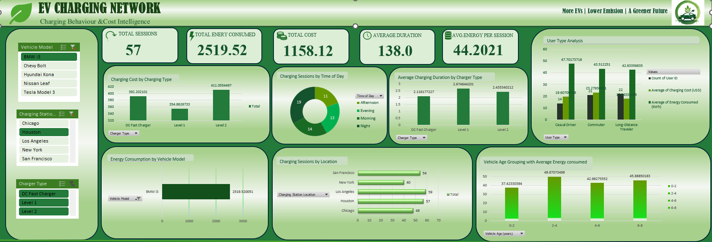

# EV Charging Network Analysis | Excel Dashboard

## Business Question
How do charging cost, energy use and session volume vary by charger type, location, time of day and user type, and where can an EV charging network focus to increase revenue?

## Dataset
| Item | Details |
|---|---|
| Name | EV Charging Network |
| Source | https://www.kaggle.com/datasets/valakhorasani/electric-vehicle-charging-patterns |
| Rows | 1,320 charging sessions |
| Columns | 20 |
| Period | 1 Jan 2024 to 24 Feb 2024 |
| Locations | 5 US cities (Los Angeles, San Francisco, Houston, New York, Chicago) |
| Vehicle models | 5 (Tesla Model 3, Hyundai Kona, Nissan Leaf, BMW i3, Chevy Bolt) |
| Charging stations | 462 |
| Missing values / duplicates | None |

### Column Description
| Column | Meaning |
|---|---|
| User ID | Unique user per session |
| Vehicle Model | EV model |
| Battery Capacity (kWh) | Battery size |
| Charging Station ID | Station used |
| Charging Station Location | City of the station |
| Charging Start Time / End Time | Session start and end |
| Energy Consumed (kWh) | Energy delivered in the session |
| Charging Duration (hours) | Length of the session |
| Charging Rate (kW) | Charging speed |
| Charging Cost (USD) | Cost of the session |
| Time of Day | Morning, Afternoon, Evening or Night |
| Day of Week | Day of the session |
| State of Charge (Start % / End %) | Battery level before and after |
| Distance Driven (since last charge) (km) | Distance since the previous charge |
| Temperature (°C) | Temperature during the session |
| Vehicle Age (years) | Age of the vehicle |
| Charger Type | Level 1, Level 2 or DC Fast Charger |
| User Type | Commuter, Casual Driver or Long-Distance Traveler |

## Tools Used
Microsoft Excel: Pivot Tables, Pivot Charts, Slicers, Dashboard 

## Workbook Structure
| Sheet | Contents |
|---|---|
| Introduction | Cover page |
| Ev_dataset | Raw data (1,320 rows, 20 columns) |
| Pivot Table | 8 pivot tables with charts |
| Dashboard | Charts and slicers |


## Dashboard




## Key Metrics (whole dataset, no slicer filters applied)
| Metric | Value |
|---|---|
| Total sessions | 1,320 |
| Total charging revenue | $29,768 |
| Average cost per session | $22.55 |
| Total energy consumed | 56,292 kWh |
| Average energy per session | 42.65 kWh |
| Average duration | 2.27 hours |
| Average charging rate | 25.95 kW |

## Key Insights
1. **Charger types are used almost equally:** Level 1 has 459 sessions, Level 2 has 431 and DC Fast Charger has 430. Each brings in about a third of revenue (DC Fast 34.1%, Level 1 33.4%, Level 2 32.5%).
2. **DC Fast Charger sessions cost the most on average ($23.60)**, compared with $22.45 for Level 2 and $21.66 for Level 1.
3. **Los Angeles is the busiest city** with 297 sessions and the highest revenue ($6,695). Chicago has the fewest sessions (242) but the highest average cost per session ($23.72).
4. **Evening is the peak time** with 362 sessions (27%) and $8,102 revenue, the most of any time of day.
5. **Commuters are the largest user group** with 476 sessions (36%) and $10,830 revenue. Average cost per session is almost the same for all user types ($22.21 to $22.75).
6. **Saturday is the busiest day** (205 sessions) and Thursday the quietest (154), although Thursday has the highest average cost ($24.30).
7. **Tesla Model 3 has the most sessions (280) and the highest average energy per session (44.4 kWh).**
8. **Differences between groups are small.** Cost, energy, duration and charging rate show almost no correlation with each other (cost vs energy is -0.01), so no single factor strongly drives cost in this dataset.


## Recommendations
- Focus capacity and maintenance on **evening hours and Los Angeles**, where demand and revenue are highest.
- Review pricing for **Level 1 and Level 2** chargers, since DC Fast Charger earns a higher cost per session with similar usage.
- Target **commuters** with subscription or loyalty plans, since they are the biggest group.
- Look into **Thursday and Chicago**, where average costs are high but session counts are low, for promotions that lift volume.

## Data Quality Notes
- 32 sessions have a state of charge above 100% (9 at start, 23 at end), 268 sessions end with a lower charge than they started, and 191 sessions report more energy than the battery capacity.
- Temperature reaches 73 degrees C and vehicle age includes decimals (up to 11.7 years).
- These values are not realistic, so the dataset appears to be synthetic. The findings describe this dataset and may not reflect a real charging network.

## Repository Structure
```
ev-charging-network-analysis/
├── EV_charging_network.xlsx
├── images/
└── README.md
```

## Author
**Afnan M** 