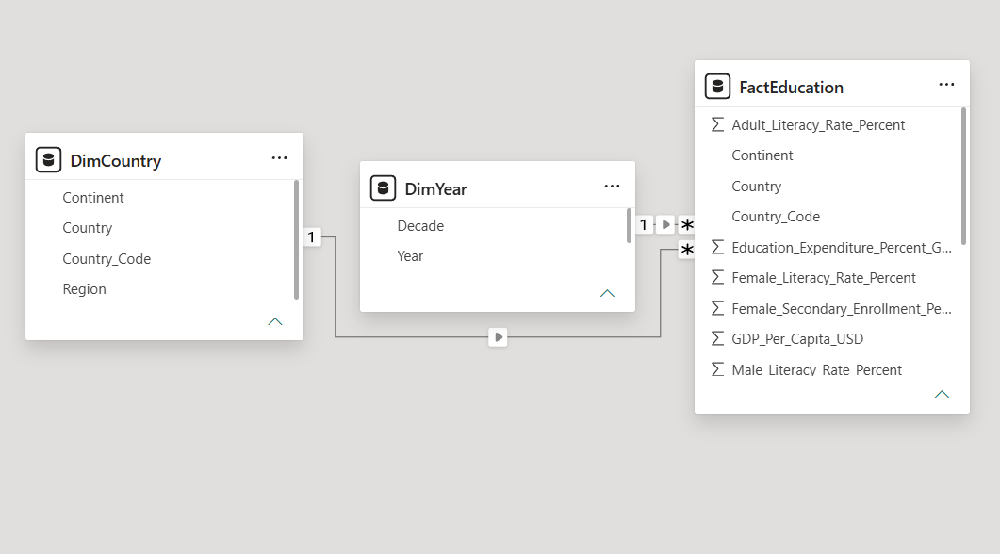

# Global Education Analytics (1975–2024)

An interactive **Power BI dashboard** exploring global education trends, literacy, enrollment, gender equity, and education investment across 20 countries over 50 years.

> **Data Disclaimer:** The dataset contains unrealistic and inconsistent values and appears to be synthetic or heavily simulated. The findings represent patterns in the supplied dataset and should not be interpreted as actual global education statistics. See [Data Quality and Limitations](#data-quality-and-limitations).

---

## Table of Contents

- [Project Overview](#project-overview)
- [Project Questions](#project-questions)
- [Project Files](#project-files)
- [Dataset](#dataset)
- [Data Model](#data-model)
- [Dashboard Pages](#dashboard-pages)
- [Key Insights](#key-insights)
- [Recommendations](#recommendations)
- [Data Quality and Limitations](#data-quality-and-limitations)
- [Tools and Technologies](#tools-and-technologies)
- [Repository Structure](#repository-structure)
- [Author](#author)

## Project Overview

This project analyzes education-related indicators across 20 countries from 1975 to 2024. It uses Power BI to explore changes in education access, literacy, enrollment, classroom resources, gender differences, and government education spending.

The dashboard includes interactive continent and decade slicers, KPI cards, charts, country rankings, and insight panels to make the findings easier to explore.

## Project Questions

- How have literacy and enrollment rates changed between 1975 and 2024?
- How does education investment vary across countries and continents?
- Is higher GDP per capita associated with higher education spending?
- Which countries have the highest pupil-teacher ratios?
- How do male and female literacy and enrollment rates compare?
- What differences exist in education investment and resources across regions?

## Project Files

- **Power BI Report:** [`global_education_analytics.pbix`](global_education_analytics.pbix)
- **Source Dataset:** [`global_education.csv`](global_education.csv)
- **Dashboard Report:** [`reports.pdf`](reports.pdf)
- **Dashboard Screenshots:** [`images`](images/)
- **Data Model:** [`images/data_model.png`](images/data_model.png)

## Dataset

| Attribute | Details |
|---|---|
| Dataset | Global Education Dataset |
| Source | [Kaggle Dataset](https://www.kaggle.com/datasets/afnanmujeeb/global-education-datatset-1975-2024) |
| Records | 1,000 |
| Countries | 20 |
| Fields | 18 |
| Time Period | 1975–2024 |
| Continents | Africa, Asia, Europe, North America, Oceania, South America |
| Missing Values / Duplicates | None reported |

**Countries included:**

Argentina, Australia, Bangladesh, Brazil, Canada, China, France, Germany, India, Indonesia, Japan, Malaysia, Mexico, New Zealand, Nigeria, Pakistan, South Africa, South Korea, the United Kingdom, and the United States.

### Dataset Fields

| Field | Description |
|---|---|
| Country, Country_Code | Country name and three-letter country code |
| Continent, Region | Continent and geographical region |
| Year | Year of observation (1975–2024) |
| Population_Millions | Population |
| GDP_Per_Capita_USD | GDP per capita in USD |
| Education_Expenditure_Percent_GDP | Education expenditure as a percentage of GDP |
| Adult_Literacy_Rate_Percent | Adult literacy rate |
| Female_Literacy_Rate_Percent | Female literacy rate |
| Male_Literacy_Rate_Percent | Male literacy rate |
| Primary_Enrollment_Rate_Percent | Primary enrollment rate |
| Secondary_Enrollment_Rate_Percent | Secondary enrollment rate |
| Tertiary_Enrollment_Rate_Percent | Tertiary enrollment rate |
| Female_Secondary_Enrollment_Percent | Female secondary enrollment |
| Male_Secondary_Enrollment_Percent | Male secondary enrollment |
| Secondary_Completion_Rate_Percent | Secondary education completion rate |
| Pupil_Teacher_Ratio | Number of pupils per teacher |

## Data Model

The report uses a **star schema** consisting of a central fact table, country and year dimension tables, and a dedicated measures table.

| Table | Purpose |
|---|---|
| FactEducation | Stores education, economic, and gender-related indicators |
| DimCountry | Contains country and continent information |
| DimYear | Contains year and decade information |
| measures_table | Stores DAX measures used in the dashboard |

### Data Model Diagram



### Key Measures

The report includes DAX measures for:

- Average adult literacy rate
- Average education expenditure
- Average GDP per capita
- Primary, secondary, and tertiary enrollment
- Secondary completion rate
- Pupil-teacher ratio
- Male and female literacy rates
- Literacy gender gap
- Secondary enrollment gender gap
- Total number of countries

## Dashboard Pages

The dashboard contains five interactive pages. Each page includes **Continent** and **Decade** slicers to support dynamic analysis.

### 1. Global Education at a Glance

Provides an overall view of global education through KPI cards, a world map, top 10 countries by adult literacy, education investment by continent, enrollment distribution, and education progress over time.


[View Global Overview Insight](images/Global%20Overview_insight.png)

### 2. The Evolution of Education

Explores changes in literacy, enrollment, and education spending over time. It includes literacy trends by continent and decade, enrollment trends across education levels, and male versus female literacy comparisons.


[View Education Trends Insight](images/Education%20Trends%20insight.png)

### 3. Education Across Nations

Compares education performance across countries and continents using literacy rankings, pupil-teacher ratios, GDP per capita, education expenditure, and country-level comparisons.


[View Country Comparisons Insight](images/Country%20Comparisons%20Insight.png)

### 4. Bridging the Gender Gap

Examines gender differences in literacy and secondary enrollment through trend comparisons, country-level gender gaps, and regional analysis.


[View Gender and Equity Insight](images/Gender%20%26%20Equity%20Insight.png)

### 5. Investing in Education's Future

Analyzes education expenditure across continents and countries, pupil-teacher ratios, spending trends over time, and the relationship between GDP per capita and education investment.


[View Investment and Resources Insight](images/Investment%20&%20Resouces%20insight.png)

## Key Insights

The following findings are calculated from the supplied dataset.

1. **Improvement in Literacy:** Average adult literacy increased from 51.8% in 1975 to 84.1% in 2024.

2. **Growth in Enrollment:** Primary enrollment increased from 55.5% to 93.2%, secondary enrollment from 20.1% to 91.2%, and tertiary enrollment from 4.4% to 51.5%.

3. **Improved Pupil-Teacher Ratio:** The average pupil-teacher ratio decreased from 37.6 in 1975 to 19.7 in 2024.

4. **Differences in Education Spending:** Oceania (5.6%), Europe (5.5%), and South America (5.5%) recorded the highest average education expenditure as a percentage of GDP. Asia (3.6%) and Africa (4.0%) recorded lower averages.

5. **Spending and Literacy Relationship:** GDP per capita and education expenditure have a moderate positive correlation (0.57). Education expenditure and literacy (-0.18), and GDP per capita and literacy (0.17), show weak correlations.

6. **Classroom Resources and Completion:** The pupil-teacher ratio and secondary completion rate have a strong negative correlation (-0.96). Secondary completion and adult literacy have a positive correlation (0.62).

7. **Gender Enrollment Gap:** Female secondary enrollment averages 53.3%, compared with 54.0% for males, indicating a difference of less than one percentage point.

## Recommendations

Based on the patterns observed in the dataset:

- Examine education access and funding in lower-spending countries.
- Monitor pupil-teacher ratios to identify countries with greater classroom pressure.
- Give attention to tertiary education enrollment, which remains lower than primary and secondary enrollment.
- Continue monitoring gender differences in literacy and enrollment.
- Evaluate whether education investment is translating into improved educational outcomes.

## Data Quality and Limitations

The dataset has several limitations that should be considered when interpreting the results:

- **Inconsistent literacy values:** Female and male literacy rates average approximately 32%–33%, while the overall adult literacy rate averages around 62%. The gender-specific fields also have a minimum value of 25%.
- **Population scale concerns:** Population values may not match the stated unit of millions. For example, India's value is 1.42, which may represent billions rather than millions.
- **Unusual country rankings:** New Zealand has the lowest average literacy rate (43.9%), while Pakistan has the highest (73.9%) in the dataset.
- **Synthetic data concerns:** Several values and relationships appear unrealistic or inconsistent with actual global education patterns.

Therefore, this dashboard should be considered an exploratory analysis of the supplied dataset rather than a source of verified real-world education statistics.

## Tools and Technologies

- **Power BI Desktop** – Dashboard creation and data visualization
- **Power Query** – Data cleaning and transformation
- **DAX** – Measures and calculations
- **CSV** – Source dataset
- **GitHub** – Project documentation and version control

## Repository Structure

```text
Power BI Dashboard/
|
+-- global_education_analytics.pbix
+-- global_education.csv
+-- reports.pdf
+-- readme.md
|
`-- images/
    |-- data_model.png
    |-- Global Overview.png
    |-- Global Overview_insight.png
    |-- Education Trends.png
    |-- Education Trends insight.png
    |-- Country Comparions .png
    |-- Country Comparisons Insight.png
    |-- Gender &Equity.png
    |-- Gender & Equity Insight.png
    |-- Investment & Resources.png
    `-- Investment & Resouces insight.png
```

## Author

**Afnan**

