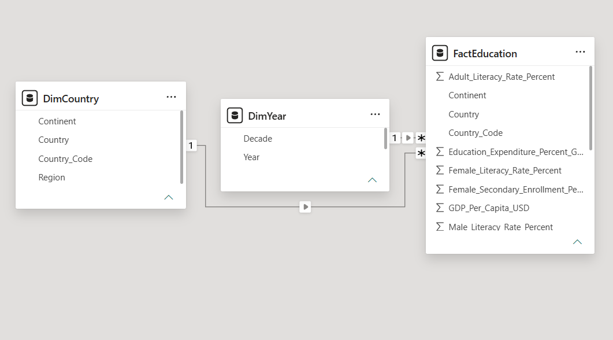

# Global Education Analytics (1975–2024)

An interactive Power BI report exploring education access, outcomes, investment, and gender equity across 20 countries over 50 years.

> **Data note:** The dataset contains unrealistic or inconsistent values and appears to be synthetic or heavily simulated. Treat the results as an analysis of this dataset, not as real-world education statistics. See [Data Quality and Limitations](#data-quality-and-limitations).

## Contents

- [Project Question](#project-question)
- [Files](#project-files)
- [Dataset](#dataset)
- [Data Model](#data-model)
- [Dashboard Pages](#dashboard-pages)
- [Key Insights](#key-insights)
- [Recommendations](#recommendations)
- [Data Quality and Limitations](#data-quality-and-limitations)
- [Tools](#tools)

## Project Question

How have education access, quality, and investment changed across countries and continents from 1975 to 2024? Where are the largest gaps in spending, enrollment, and gender equity?

## Project Files

- [Open the Power BI report](global%20education%20powerbi.pbix)
- [View the source dataset](global_education.csv)

## Dataset

| Item | Details |
|---|---|
| Name | Global Education Dataset |
| Source | [Kaggle](https://www.kaggle.com/datasets/afnanmujeeb/global-education-datatset-1975-2024) |
| Records | 1,000 (20 countries × 50 years) |
| Fields | 18 |
| Period | 1975–2024 |
| Continents | Africa, Asia, Europe, North America, Oceania, and South America |
| Missing values / duplicates | None reported |

**Countries:** Argentina, Australia, Bangladesh, Brazil, Canada, China, France, Germany, India, Indonesia, Japan, Malaysia, Mexico, New Zealand, Nigeria, Pakistan, South Africa, South Korea, the United Kingdom, and the United States.

### Fields

| Field | Description |
|---|---|
| Country, Country_Code | Country name and three-letter code |
| Continent, Region | Continent and sub-region |
| Year | Record year (1975–2024) |
| Population_Millions | Population |
| GDP_Per_Capita_USD | GDP per person in US dollars |
| Education_Expenditure_Percent_GDP | Education spending as a share of GDP |
| Adult_Literacy_Rate_Percent | Adult literacy rate |
| Female_Literacy_Rate_Percent, Male_Literacy_Rate_Percent | Literacy rate by gender |
| Primary_Enrollment_Rate_Percent, Secondary_Enrollment_Rate_Percent, Tertiary_Enrollment_Rate_Percent | Enrollment rate by education level |
| Female_Secondary_Enrollment_Percent, Male_Secondary_Enrollment_Percent | Secondary enrollment rate by gender |
| Secondary_Completion_Rate_Percent | Secondary school completion rate |
| Pupil_Teacher_Ratio | Number of pupils per teacher |

## Data Model

The report uses a star schema with a fact table, country and year dimensions, and a dedicated measures table.

| Table | Purpose |
|---|---|
| FactEducation | Education, economic, and gender indicators for each country and year |
| DimCountry | Country and continent attributes |
| DimYear | Year and decade attributes |
| measures_table | DAX measures used in the report |



### Measures

The report includes average adult literacy, education expenditure, GDP per capita, primary/secondary/tertiary enrollment, secondary completion, pupil-teacher ratio, male and female literacy, literacy and enrollment gender gaps, and total countries.

## Dashboard Pages

Each page includes **Continent** and **Decade** slicers.

### 1. Global Overview

KPI cards, a world map, top 10 countries by adult literacy, education investment by continent, enrollment distribution, and progress over time.


### 2. Country Comparisons

Education performance by continent, top countries by literacy, pupil-teacher ratio by country, GDP versus education expenditure, and a country ranking table.


### 3. Investment and Resources

Education investment over time, expenditure by continent and country, pupil-teacher ratios by continent, and GDP per capita versus education investment.


### 4. Education Trends

Literacy by decade, adult literacy growth, enrollment trends by education level, education expenditure trends, and male versus female literacy over time.


### 5. Gender and Equity

Male and female literacy trends, literacy gaps by country, female versus male secondary enrollment, and a gender gap comparison table.


## Key Insights

Figures below are calculated from the dataset; comparisons by year use the respective year's records.

1. **Literacy increased over time:** average adult literacy rose from 51.8% in 1975 to 84.1% in 2024.
2. **Enrollment grew, especially at higher levels:** primary enrollment increased from 55.5% to 93.2%, secondary from 20.1% to 91.2%, and tertiary from 4.4% to 51.5%.
3. **Pupil-teacher ratios declined:** the average fell from 37.6 in 1975 to 19.7 in 2024.
4. **Education spending varies by continent:** Oceania (5.6% of GDP), Europe (5.5%), and South America (5.5%) have the highest averages; Asia (3.6%) and Africa (4.0%) have the lowest. South Africa has the highest country average (5.9%) and Nigeria the lowest (2.1%).
5. **Spending does not closely track literacy in this dataset:** GDP per capita and education spending have a moderate positive correlation (0.57), while spending and literacy (-0.18) and GDP and literacy (0.17) have weak correlations.
6. **Lower pupil-teacher ratios are associated with higher completion:** their correlation is -0.96; secondary completion and adult literacy have a correlation of 0.62.
7. **The reported gender gap in secondary enrollment is small:** female enrollment averages 53.3%, compared with 54.0% for males, with a gap under one percentage point in each continent.

## Recommendations

- Investigate education access and funding in lower-spending countries, while checking how spending reaches schools and classrooms.
- Continue monitoring pupil-teacher ratios alongside secondary completion.
- Prioritize tertiary enrollment, which remains the lowest of the three education levels in the 2024 records.

## Data Quality and Limitations

- Female and male literacy rates average about 32%–33%, while adult literacy averages 62%; both gender-specific fields also have a floor of 25%. Interpret gender literacy comparisons with caution.
- Population values may use a different scale than the `Population_Millions` field suggests. For example, India's value is 1.42, which may represent billions rather than millions.
- Some country rankings appear implausible; for example, New Zealand has the lowest average literacy (43.9%) and Pakistan the highest (73.9%) in the dataset.
- Given these issues, the dataset appears synthetic or heavily simulated. Findings describe the supplied data and should not be treated as real-world facts.

## Tools

Power BI Desktop, Power Query, and DAX.

## Repository Structure

```text
Power BI Dashboard/
├── global education powerbi.pbix
├── global_education.csv
├── images/
│   ├── Country Comparions.png
│   ├── data_model.png
│   ├── Education Trends.png
│   ├── Gender &Equity.png
│   ├── Global Overview.png
│   └── Investment &Resources.png
└── readme.md
```

## Author

**Afnan M**
